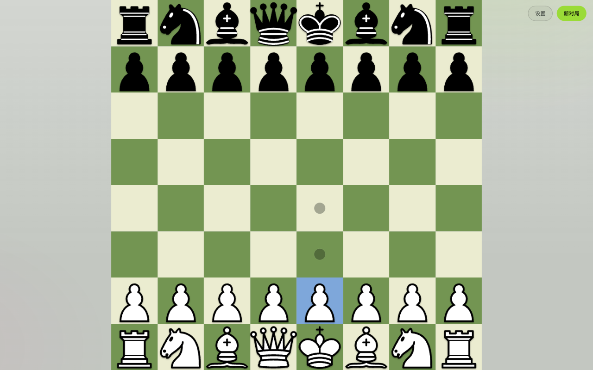

# 国际象棋

React 加 Vite 的纯前端国际象棋，可部署到 Vercel。

在线试玩：https://chess-beryl-five.vercel.app/

## 功能

1. 人机三档难度与双人模式，AI 在 Web Worker 计算，置换表加持，失败回退主线程。
2. 选中保持、按距离滑行、自动升后、悔棋、提示、认输、键盘操作。
3. 背景与主题色可调，音量可调，对局历史可查看每局走法并导出 JSON。
4. 支持离线安装；宽屏结算卡在右侧，窄屏在底部，只显示胜负与 不服再来。

## 运行

1. `npm install`
2. `npm run dev`，访问 http://127.0.0.1:8000/
3. 或执行 `./just_run.sh`，自动装依赖、探测端口、打开页面。
4. 构建 `npm run build`，产物在 dist。

## 部署

Vercel 导入仓库，自动识别 Vite，构建 `npm run build`，输出 dist。

## 目录

1. src/game：引擎、AI、开局库、状态仓库、Worker。
2. src/components：棋盘、设置抽屉、结算卡、提示条。
3. legacy：旧原生 JS 版本，仅作对照。
4. tests：引擎 19 项与 AI 17 项，执行 `npm test`。

## 致谢

棋子使用 cburnett 套装，作者 Colin M.L. Burnett，授权 CC BY-SA 3.0。
